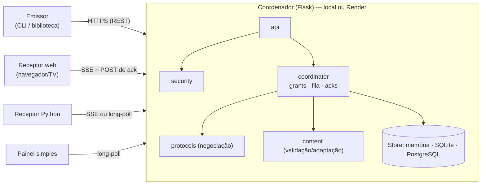

# OmniLink — descoberta e negociação de comunicação entre dispositivos heterogêneos

Protótipo **funcional e testado** de um sistema que descobre dispositivos, compara suas capacidades, negocia versão,
transporte, codec e formato, adapta o conteúdo ao receptor e entrega **texto, imagens e HTML** com confirmação de
recebimento — com autorização explícita, limites e diagnósticos claros quando não há canal compatível.

> **Leitura honesta em 30 segundos.** O OmniLink demonstra que a negociação automática funciona **entre dispositivos que
> oferecem um mecanismo comum** (um cliente Python ou um navegador). Ele **não** faz um aparelho que não escuta, não tem
> navegador ou não aceita o remetente passar a receber conteúdo: isso é impossível sem contornar proteções, o que o
> projeto recusa. Veja o veredito completo em [docs/RELATORIO_TECNICO.md](docs/RELATORIO_TECNICO.md).

| Situação | Estado |
|---|---|
| API Flask (REST + SSE + long-poll), negociação, adaptação, autorização, fila, confirmações, reentrega, revogação | ✔ demonstrado — 263 testes automatizados |
| Receptor web (navegador) | ✔ testado em Chromium real; outros navegadores não testados |
| Persistência SQLite e recuperação após reinício | ✔ demonstrado |
| Descoberta na LAN (UDP próprio) | ✔ em loopback; LAN real (broadcast/multicast) não testada |
| PostgreSQL, `gunicorn`, implantação real no Render | ◐ escritos conforme a documentação; **não executados** aqui |
| WebSocket, mDNS, adaptadores Cast/AirPlay/DLNA, app Android/TV, criptografia ponta a ponta | ✘ não implementados (roadmap) |

## 1. Objetivo

Investigar — e demonstrar com código real — uma forma de **descobrir e negociar automaticamente meios de comunicação**
entre dispositivos diferentes, distinguindo claramente: o que é possível, o que exige suporte prévio do dispositivo e o
que não pode ser garantido. Detectar um dispositivo, conectar-se a ele e agir nele são **três degraus distintos**; o
sistema nunca presume o seguinte a partir do anterior.

## 2. Arquitetura e componentes



Todos os dispositivos abrem conexões de **saída** até o coordenador (funciona atrás de NAT/firewall); um servidor na
nuvem não enxerga a sua LAN. Módulos (detalhes em [docs/ARQUITETURA_E_PROTOCOLO.md](docs/ARQUITETURA_E_PROTOCOLO.md)):

| Módulo | Diretório | Função |
|---|---|---|
| `discovery` | `app/discovery/` | Descoberta UDP na LAN, catálogo de tipos mDNS/SSDP |
| `capabilities` | `app/capabilities/` | Documento de capacidades e perfis |
| `protocol_engine` | `app/protocols/` | Registro de protocolos e motor de negociação |
| `transport` | `app/transport/` | Transportes do receptor (`sse`, `http-longpoll`) |
| `message_codec` | `app/codec/` | Mensagens; codecs `json-b64` e `binary-frame` |
| `content_engine` | `app/content/` | Texto, HTML (sanitização) e imagens |
| `receiver` | `app/receiver/` | Validação independente, apresentação, reconexão limitada |
| `security` | `app/security/` | Tokens, limites de taxa, validação |
| `diagnostics` | `app/diagnostics/` | Códigos, relatórios, logs sem segredos, auditoria |
| `api` | `app/api/` | Rotas Flask e página do receptor |
| `cloud_coordinator` | `app/coordinator/` | Serviço central e armazenamento |

**Por que Flask?** É o que está disponível e testável sem rede neste ambiente, basta para requisição/resposta + SSE/long-poll
e a lógica fica fora do framework. **WebSocket** foi avaliado e **não é necessário** nesta versão (justificativa no relatório).

## 3. Requisitos de software

* Python **3.10 ou superior** (testado em 3.12.3), `pip` e `venv`.
* Dependências em `requirements.txt`: Flask, Pillow, requests (+ `gunicorn` no servidor e `psycopg[binary]` só com PostgreSQL).
* Opcional, para os testes em navegador: `pip install playwright && playwright install chromium`.
* Linux (testado), macOS ou Windows (não testados). `gunicorn` não roda no Windows: lá use `python -m app.api`.

## 4. Instalação no notebook

```bash
# 1) obtenha o projeto (ZIP descompactado ou git clone) e entre na pasta
cd omnilink
```

## 5. Ambiente Python

```bash
# Linux / macOS
python3 -m venv .venv
source .venv/bin/activate
pip install -r requirements.txt
```

```powershell
# Windows (PowerShell)
py -3.12 -m venv .venv
.\.venv\Scripts\Activate.ps1
pip install -r requirements.txt
```

Execute **todos os comandos a partir da pasta `omnilink`** (os módulos são importados como `app.…`).

## 6. Execução local

```bash
export OMNILINK_ENV=development
export OMNILINK_ENROLLMENT_KEY="uma-chave-longa-e-aleatoria"      # Windows: $env:OMNILINK_ENROLLMENT_KEY="..."
export OMNILINK_DATABASE_URL="sqlite:///omnilink.db"              # opcional: mantém dispositivos entre reinícios
python -m app.api --port 8000
```

Abra `http://127.0.0.1:8000/health`. Para aceitar **outros aparelhos da rede local** (celular, TV com navegador) use
`--host 0.0.0.0` — é HTTP puro: só em redes que você controla. Sem a chave definida, o modo de desenvolvimento gera uma
chave efêmera e a imprime no console.

Demonstração completa em um só comando (servidor e clientes no mesmo processo; saída em `docs/demo_output.txt`):

```bash
python examples/demo_local.py
```

## 7. Conexão dos clientes

Em outros terminais (ativando o mesmo ambiente). A chave de registro vem da variável de ambiente, não da linha de comando:

```bash
export OMNILINK_ENROLLMENT_KEY="a mesma chave do servidor"
python -m app.client register --server http://127.0.0.1:8000 --name notebook-receptor --profile python-receiver --out ~/.omnilink/receptor.json
python -m app.client register --server http://127.0.0.1:8000 --name notebook-emissor  --profile python-sender   --out ~/.omnilink/emissor.json

python -m app.client devices -c ~/.omnilink/emissor.json            # descoberta: quem existe, quem está online
python -m app.client caps DEV_ID_DO_RECEPTOR -c ~/.omnilink/emissor.json
```

Perfis prontos: `python-receiver`, `python-sender`, `browser-receiver`, `constrained-receiver`, `legacy-receiver` (este
último existe para **demonstrar diagnósticos de incompatibilidade**). O arquivo de credenciais é criado com permissão
`0600` e o token nunca é impresso.

Iniciar o receptor (um terminal próprio; `Ctrl+C` encerra):

```bash
python -m app.client receive -c ~/.omnilink/receptor.json                          # pergunta ao chegar um pedido de autorização
python -m app.client receive -c ~/.omnilink/receptor.json --allow DEV_ID_DO_EMISSOR  # aprova só esse emissor
```

## 8. Transmissão de mensagens e imagens

```bash
python -m app.client negotiate -c ~/.omnilink/emissor.json --to DEV_ID --kind image --file foto.png   # simula, não envia
python -m app.client send -c ~/.omnilink/emissor.json --to DEV_ID text  "Olá!"            --wait 10
python -m app.client send -c ~/.omnilink/emissor.json --to DEV_ID image foto.png          --wait 10
python -m app.client send -c ~/.omnilink/emissor.json --to DEV_ID html  pagina.html       --wait 10
```

* **Primeiro envio:** o coordenador responde `NOT_AUTHORIZED` e notifica o receptor; ele aprova (prompt do `receive`,
  cartão na página web ou `python -m app.client grant allow ID_DO_EMISSOR --kinds text image html -c ~/.omnilink/receptor.json`) e você reenvia.
  A autorização é **por tipo de conteúdo** e pode ser revogada (`grant revoke`).
* `--wait N` espera até N segundos pela confirmação (`displayed`) e informa o estado final; o código de saída é 0 quando entregue.
* Se não houver canal compatível, a CLI explica **por quê** e propõe alternativas (código de saída 2).
* Imagens são validadas, e **adaptadas** ao receptor quando necessário (reduzir/recodificar); HTML é sanitizado;
  texto vira UTF-8 limpo. O que foi adaptado aparece em `adapted`.

Pela biblioteca Python:

```python
from app.client import OmniLinkClient
from app.capabilities.profiles import python_sender

c = OmniLinkClient("http://127.0.0.1:8000")
c.register("a-chave-de-registro", python_sender("meu-script"))
reply = c.send_text("dev_…", "Olá!")                       # levanta ApiError(code="NOT_AUTHORIZED") na primeira vez
print(c.message_status(reply["message_id"], wait=10)["status"])   # displayed
```

## 9. Apresentação de conteúdo HTML

* **Receptor web (recomendado):** em qualquer aparelho com navegador acesse `http://IP-DO-SERVIDOR:8000/receiver`
  (em produção: `https://SEU-SERVICO.onrender.com/receiver`), informe a chave de registro e deixe a página aberta. Texto,
  imagens e HTML aparecem com a confirmação enviada automaticamente; pedidos de autorização surgem como cartões
  *Permitir/Negar*. O HTML roda em `iframe` **sem scripts, formulários, popups nem navegação**, com CSP restritiva. Navegadores
  sem suporte a *streaming* usam long-poll automaticamente.
* **Receptor Python:** `receive --open-html` grava o HTML **já sanitizado** em `inbox/<id>.html` (com CSP embutida) e o abre no navegador padrão.

## 10. Executar os testes

```bash
python -m unittest discover -s tests -t . -v        # ou: pytest
```

263 testes (≈ 1 min 15 s). Os 11 testes de navegador são **ignorados automaticamente** se Playwright/Chromium não estiverem
instalados. Cobrem: serialização, negociação, seleção de protocolos, validação de arquivos/entradas, autenticação e
autorização, envio/recebimento (inclusive com servidor e clientes reais), falhas de conexão, recuperação de sessões, API e
perfil de produção. Verificação do serviço **já implantado**: `python examples/smoke_remote.py --url https://…`.

## 11. Implantação no Render

Resumo (passo a passo, plano gratuito e solução de problemas em [docs/DEPLOY_RENDER.md](docs/DEPLOY_RENDER.md)):

1. `git push` do projeto para GitHub/GitLab/Bitbucket (o `.gitignore` protege segredos).
2. Render → **New → Blueprint** → escolha o repositório: o `render.yaml` cria o serviço web (`gunicorn`, `/health`) e o PostgreSQL.
3. Leia `OMNILINK_ENROLLMENT_KEY` em *Environment* e rode `python examples/smoke_remote.py --url https://SEU-SERVICO.onrender.com`.

**Atenção (plano gratuito):** a instância dorme após 15 min sem tráfego e o PostgreSQL gratuito **expira em 30 dias**.

## 12. Variáveis de ambiente

| Variável | Para quê |
|---|---|
| `OMNILINK_ENV` | `development` ou `production` (produção exige chave forte e liga HTTPS/logs JSON) |
| `OMNILINK_ENROLLMENT_KEY` | Segredo para registrar/revogar dispositivos (≥ 16 caracteres em produção) |
| `OMNILINK_DATABASE_URL` / `DATABASE_URL` | Vazio = memória; `sqlite:///arq.db` ou `postgresql://…` = persistente |
| `PORT` | Porta do servidor de desenvolvimento (no Render é injetada) |
| `OMNILINK_RATE_LIMIT_PER_MINUTE`, `OMNILINK_MAX_IMAGE_BYTES`, … | Limites (lista completa em [docs/ARQUITETURA_E_PROTOCOLO.md](docs/ARQUITETURA_E_PROTOCOLO.md#11-configuração-variáveis-de-ambiente)) |

Modelo sem segredos: `.env.example`. Exemplos de configuração: `examples/`.

## 13. Limitações técnicas

* **Não há "idioma universal":** um dispositivo precisa ter um receptor compatível (navegador em `/receiver` ou agente). Detectar ≠ conectar ≠ agir.
* **O coordenador vê o conteúdo** (sem criptografia ponta a ponta). Instância única; 1 thread por receptor conectado.
* Descoberta na LAN só entre peers OmniLink e sem autenticação; mDNS/SSDP não implementados.
* Plano gratuito do Render: suspensão por inatividade e PostgreSQL com validade de 30 dias.
* Testado apenas em Linux, Python 3.12 e Chromium 141. PostgreSQL, `gunicorn` e o Render real **não** foram exercitados.
* Lista completa (e riscos) em [docs/RELATORIO_TECNICO.md](docs/RELATORIO_TECNICO.md#10-riscos-e-limitações-conhecidas) e [docs/SEGURANCA.md](docs/SEGURANCA.md).

## 14. Erros comuns e soluções

| Mensagem / sintoma | Causa | Solução |
|---|---|---|
| `ModuleNotFoundError: No module named 'app'` | Comando fora da pasta do projeto | `cd omnilink` antes de executar |
| `Falha de conexão` / `Connection refused` | Servidor parado ou URL/porta errada | Inicie `python -m app.api`; confira `--server`; porta ocupada: `--port 8001` |
| `ENROLLMENT_DENIED` | Chave de registro diferente da do servidor | Use o mesmo valor de `OMNILINK_ENROLLMENT_KEY` |
| `NOT_AUTHORIZED` | **Esperado no 1º envio**: o receptor ainda não autorizou | Aprove no receptor (prompt, cartão web ou `grant allow`) e reenvie |
| `ROLE_MISMATCH` | Dispositivo registrado como receptor tentou enviar | Registre com `--profile python-sender` |
| `NO_COMMON_TRANSPORT` / `NO_COMMON_CODEC` / `PROTOCOL_VERSION_MISMATCH` | Receptor fala outra coisa | Leia as alternativas na saída; abra `/receiver` no aparelho |
| `INVALID_IMAGE` / `SIZE_LIMIT_EXCEEDED` | Arquivo corrompido, formato não suportado ou acima do limite | Envie PNG/JPEG/GIF/WebP íntegros dentro dos limites |
| `AUTH_INVALID` após reiniciar o servidor | Estado em memória foi perdido | Defina `OMNILINK_DATABASE_URL=sqlite:///omnilink.db` e registre de novo |
| `RECEIVER_OFFLINE` (aviso) | Receptor desconectado | A mensagem fica na fila (1 h por padrão) e é entregue ao reconectar |
| `RATE_LIMITED` | Muitas requisições ou registros | Aguarde `Retry-After`; ajuste os limites |
| Celular não acessa `http://IP:8000/receiver` | Servidor em `127.0.0.1`, firewall ou redes diferentes | `--host 0.0.0.0`, libere a porta, mesma rede Wi-Fi |
| Página: "credencial inválida ou revogada" | Dispositivo revogado ou servidor reiniciado sem banco | Registre de novo na página |
| Testes de navegador "skipped" | Playwright/Chromium ausentes | `pip install playwright && playwright install chromium` |
| Render: primeira chamada demora ~1 min | Instância gratuita acordando | Aguarde; os clientes reconectam sozinhos |

## 15. Próximos passos

Em ordem de valor ÷ risco (detalhes no [relatório, seção 11](docs/RELATORIO_TECNICO.md#11-próximos-passos--etapa-f-expansão)):
validar PostgreSQL e o *deploy* real · receptor **Android/Android TV** (Java/Kotlin) · mDNS/DNS-SD · transporte WebSocket (plugin) ·
`lan-direct` com pareamento · criptografia ponta a ponta · adaptadores DLNA/Cast/AirPlay (só para dispositivos que os aceitam) · WebRTC · contas e várias instâncias.

## Estrutura do repositório

```
omnilink/
├── app/
│   ├── api/
│   │   ├── static/
│   │   │   ├── receiver.css
│   │   │   ├── receiver.html
│   │   │   └── receiver.js
│   │   ├── __init__.py
│   │   ├── __main__.py
│   │   ├── factory.py
│   │   └── routes.py
│   ├── capabilities/
│   │   ├── __init__.py
│   │   ├── models.py
│   │   └── profiles.py
│   ├── client/
│   │   ├── __init__.py
│   │   ├── __main__.py
│   │   ├── api.py
│   │   ├── cli.py
│   │   └── retry.py
│   ├── codec/
│   │   ├── __init__.py
│   │   ├── binary_codec.py
│   │   ├── json_codec.py
│   │   └── message.py
│   ├── content/
│   │   ├── __init__.py
│   │   ├── engine.py
│   │   ├── html_sanitizer.py
│   │   ├── images.py
│   │   └── text.py
│   ├── coordinator/
│   │   ├── __init__.py
│   │   ├── service.py
│   │   └── store.py
│   ├── diagnostics/
│   │   ├── __init__.py
│   │   ├── codes.py
│   │   ├── logs.py
│   │   └── report.py
│   ├── discovery/
│   │   ├── __init__.py
│   │   ├── catalog.py
│   │   ├── manager.py
│   │   └── udp.py
│   ├── protocols/
│   │   ├── __init__.py
│   │   ├── engine.py
│   │   └── registry.py
│   ├── receiver/
│   │   ├── __init__.py
│   │   ├── presenters.py
│   │   ├── runner.py
│   │   └── service.py
│   ├── security/
│   │   ├── __init__.py
│   │   ├── ratelimit.py
│   │   ├── tokens.py
│   │   └── validation.py
│   ├── transport/
│   │   ├── __init__.py
│   │   ├── base.py
│   │   ├── longpoll.py
│   │   └── sse.py
│   ├── __init__.py
│   ├── config.py
│   └── errors.py
├── docs/
│   ├── ARQUITETURA_E_PROTOCOLO.md
│   ├── DEPLOY_RENDER.md
│   ├── RELATORIO_TECNICO.md
│   ├── SEGURANCA.md
│   ├── benchmark_output.txt
│   └── demo_output.txt
├── examples/
│   ├── benchmark_local.py
│   ├── capabilities.browser-receiver.json
│   ├── capabilities.constrained-receiver.json
│   ├── credentials.example.json
│   ├── demo_local.py
│   └── smoke_remote.py
├── tests/
│   ├── __init__.py
│   ├── helpers.py
│   ├── test_api.py
│   ├── test_browser_receiver.py
│   ├── test_cli.py
│   ├── test_client_resilience.py
│   ├── test_codec.py
│   ├── test_content.py
│   ├── test_coordinator.py
│   ├── test_discovery.py
│   ├── test_e2e_real_sockets.py
│   ├── test_examples.py
│   ├── test_production_profile.py
│   ├── test_protocol_engine.py
│   ├── test_security.py
│   └── test_store.py
├── .env.example
├── .gitignore
├── .python-version
├── render.yaml
├── requirements-dev.txt
├── requirements.txt
└── wsgi.py
```

## Documentação

* [Relatório técnico — viabilidade e resultados](docs/RELATORIO_TECNICO.md)
* [Arquitetura e protocolo](docs/ARQUITETURA_E_PROTOCOLO.md) (diagramas, API, formatos, códigos de diagnóstico)
* [Implantação no Render](docs/DEPLOY_RENDER.md) · [Segurança](docs/SEGURANCA.md)
* Saídas reais: [`docs/demo_output.txt`](docs/demo_output.txt) · [`docs/benchmark_output.txt`](docs/benchmark_output.txt)
