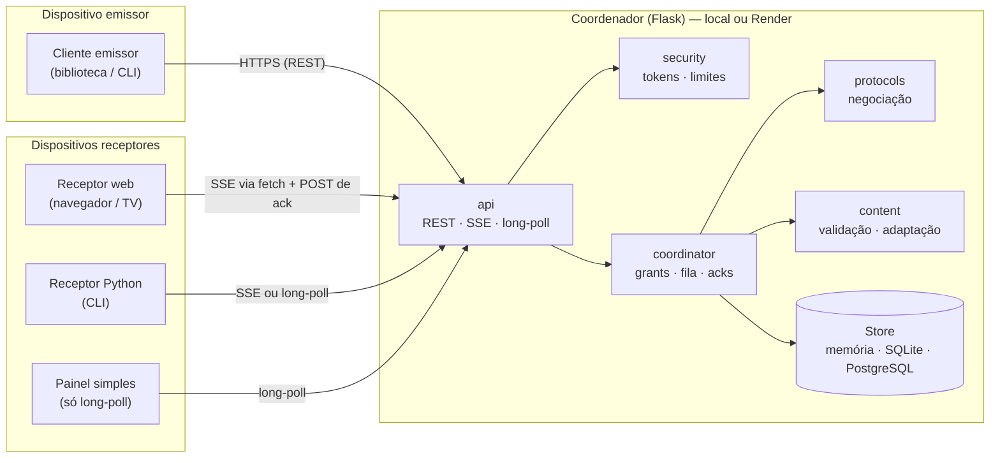
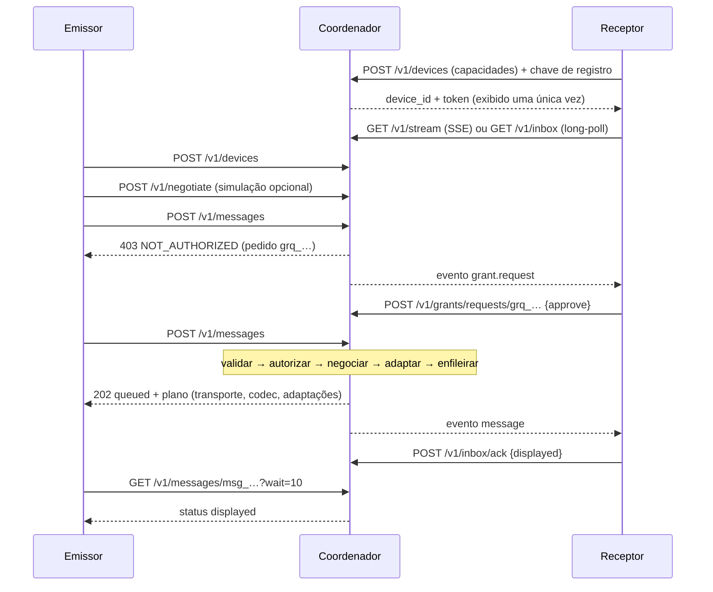

# Arquitetura e protocolo do OmniLink v0.1

Este documento descreve **o que foi realmente implementado**. O que ainda não existe aparece explicitamente em
[RELATORIO_TECNICO.md](RELATORIO_TECNICO.md) (seção "Demonstrado × implementado × não implementado").

## 1. Visão geral



Versão em texto (para quem não renderiza Mermaid):

```
   EMISSOR                      COORDENADOR (Flask)                          RECEPTORES
  ┌────────┐   HTTPS/REST   ┌───────────────────────────────┐   SSE / long-poll   ┌────────────────┐
  │ cliente├───────────────►│ api ─► security (token, taxa) │◄────────────────────┤ receptor web   │
  │ / CLI  │◄───────────────┤  │                            │  POST ack/decisão   ├────────────────┤
  └────────┘  status/acks   │  └─► coordinator ─► protocols │◄────────────────────┤ receptor Python│
                            │         │    └────► content   │                     ├────────────────┤
                            │         └────────► Store      │◄────────────────────┤ painel simples │
                            │     (memória│SQLite│Postgres) │                     └────────────────┘
                            └───────────────────────────────┘
   Todas as conexões partem dos dispositivos para o coordenador (saída): funciona atrás de NAT/firewall.
```

**Princípio central:** nenhum dispositivo precisa ser alcançável de fora. Emissores e receptores abrem conexões de
*saída* autenticadas até o coordenador, que negocia, valida, enfileira e encaminha. O coordenador **não** descobre
nada na rede privada do usuário por conta própria (um servidor na nuvem não enxerga a LAN).

## 2. Módulos (enunciado → código)

| Módulo pedido | Diretório | Responsabilidade | Ponto de extensão |
|---|---|---|---|
| `discovery` | `app/discovery/` | Descoberta na LAN (UDP próprio, testado em loopback), catálogo de tipos mDNS/SSDP e relatório | novo provedor = nova função em `manager.discover` |
| `capabilities` | `app/capabilities/` | Documento de capacidades (validação estrita), perfis prontos | novos campos são ignorados por versões antigas |
| `protocol_engine` | `app/protocols/` | Registro de transportes/codecs e **motor de negociação** (função pura) | `ProtocolRegistry.register_transport/codec` |
| `transport` | `app/transport/` | Transportes do receptor: `sse`, `http-longpoll` | `register_transport(nome, fábrica)` |
| `message_codec` | `app/codec/` | Mensagem canônica; codecs `json-b64` e `binary-frame` | `register_codec(codec)` |
| `content_engine` | `app/content/` | Texto, sanitização de HTML, validação/adaptação de imagens | novas operações em `apply_adaptations` |
| `receiver` | `app/receiver/` | Validação independente, deduplicação, apresentação, laço com reconexão limitada | novos `Presenter` |
| `security` | `app/security/` | Tokens, limitador de taxa, validação de entradas | — |
| `diagnostics` | `app/diagnostics/` | Catálogo de códigos, relatório legível, logs com redação, trilha de auditoria | novos códigos em `CATALOG` |
| `api` | `app/api/` | Fábrica Flask, rotas REST/SSE, cabeçalhos de segurança, página do receptor | — |
| `cloud_coordinator` | `app/coordinator/` | Serviço central (grants, fila, entrega, acks) e `Store` | novo `Store` (ex.: Redis) implementando a interface |
| (apoio) | `app/client/` | Cliente HTTP, política de reconexão, CLI | — |

Os módulos dependem apenas "para baixo" (`api → coordinator → protocols/content/codec → capabilities/security →
errors/diagnostics`); `protocols` e `codec` não conhecem Flask.

## 3. Fluxo ponta a ponta



Os três degraus são distintos e cada falha é diagnosticada no degrau certo:
**detectar** (`GET /v1/devices` — `RECEIVER_UNKNOWN`), **conectar** (negociação — `NO_COMMON_TRANSPORT`, `NO_COMMON_CODEC`,
`PROTOCOL_VERSION_MISMATCH`) e **agir** (autorização e entrega — `NOT_AUTHORIZED`, `CONTENT_UNSUPPORTED`).

## 4. Estados de uma mensagem

| Estado | Quem causa | Observações |
|---|---|---|
| `queued` | `POST /v1/messages` aceito | conteúdo guardado até o TTL (`OMNILINK_QUEUE_TTL_SECONDS`) |
| `sent` | coordenador entregou ao canal do receptor (SSE/long-poll) | reentregue se não houver ack em `redeliver_after_seconds` (20 s), até `max_delivery_attempts` (5) |
| `delivered` | ack do receptor (validou e aceitou) | **o conteúdo é apagado do armazenamento** |
| `displayed` | ack do receptor (apresentou) | pode suceder `delivered` |
| `rejected` | ack do receptor (recusou; `reason` explica) | ex.: `INTEGRITY_FAILED`, `CONTENT_UNSUPPORTED` |
| `failed` | tentativas de entrega esgotadas | `DELIVERY_ATTEMPTS_EXCEEDED` |
| `expired` | TTL esgotado sem entrega | detectado ao consultar/coletar |

Entrega **ao-menos-uma-vez** + deduplicação por `id` no receptor + `client_id` (idempotência) no emissor =
efeito de "exatamente uma apresentação".

## 5. Documento de capacidades

```json
{
  "schema": 1,
  "name": "painel-simples",
  "platform": "embedded",
  "roles": ["receiver"],
  "protocol_versions": [1],
  "transports": ["http-longpoll"],
  "codecs": ["json-b64"],
  "content": {
    "text":  {"max_bytes": 4000, "mimes": ["text/plain"], "max_chars": 1000},
    "image": {"max_bytes": 60000, "mimes": ["image/jpeg"], "max_width": 160, "max_height": 120}
  },
  "features": []
}
```

Validação estrita (`app/capabilities/models.py`): nomes ≤ 64 caracteres sem controles; listas ≤ 16 itens com padrão
`[a-z0-9][a-z0-9._+-]{0,39}`; papéis ∈ {`sender`, `receiver`}; tipos de conteúdo ∈ {`text`, `image`, `html`}; MIMEs
restritos por tipo (`text/plain`, `text/html`, PNG/JPEG/GIF/WebP); limites inteiros em faixas fixas. Chaves
desconhecidas no topo são **ignoradas** (compatibilidade futura); valores inválidos são **rejeitados**.

## 6. Negociação (`app/protocols/engine.py`)

Função pura `negotiate(emissor, receptor, conteúdo, contexto, registro)`:

1. **Papéis** — emissor precisa declarar `sender`; receptor, `receiver`.
2. **Versão** — interseção de `protocol_versions` com as do coordenador; usa a maior.
3. **Conteúdo** — o receptor aceita o tipo/MIME/tamanho? Se não e a adaptação é permitida, planeja `html_to_text` ou
   `fit_image` (reduzir, recodificar, encolher). Texto acima do limite **não** é truncado: é erro.
4. **Transporte × codec** — candidatos = transportes do receptor *conhecidos e implementados* (`ws` e `lan-direct` são
   conhecidos mas não implementados → aviso `TRANSPORT_NOT_IMPLEMENTED`) × codecs compatíveis (`binary-frame` exige
   transporte com suporte binário). Política TLS pode excluir candidatos.
5. **Pontuação** — `peso = min(1, tamanho / 256 KiB)`; `pontos = (1−peso)·(0,7·latência + 0,3·eficiência) +
   peso·(0,3·latência + 0,7·eficiência)`; **+40** para o transporte em que o receptor está conectado agora.

Resultado: `compatible`, `selection` (versão, transporte, codec, adaptações), `diagnostics`, `alternatives` e
`considered` (cada combinação avaliada e o motivo de cada descarte). Exemplo real (`docs/demo_output.txt`), mesma imagem
de ~920 KB:

| Receptor | Plano escolhido |
|---|---|
| notebook (SSE, json) | `sse + json-b64` (o receptor está em SSE; o transporte ativo vence) |
| navegador-tv (só json) | `sse + json-b64` |
| estação de trabalho (conectada por long-poll, binário) | `http-longpoll + binary-frame` (o codec binário é o mais eficiente que ambos entendem) |
| painel-simples (limitado) | `http-longpoll + json-b64` com `fit_image` (JPEG ≤ 160×120) |
| equipamento-antigo (`ws`, `cbor`, v2) | **incompatível**, com 5 diagnósticos e 4 alternativas |

**Extensão sem reescrever o motor** (testado em `tests/test_protocol_engine.py::ExtensibilityTests`):

```python
registry = default_registry()
registry.register_transport(TransportSpec("ws", score=90, supports_binary=True, implemented=True))
registry.register_codec(CodecSpec("cbor", score=95, binary=True))
negotiate(emissor, receptor, conteudo, registry=registry)   # passa a escolher ws + cbor se ambos suportarem
```

## 7. Mensagens e codecs

Mensagem canônica (`app/codec/message.py`): `id` (`msg_` + 24 hex), `from`/`to` (`dev_` + 16 hex), `kind`
(`text`/`image`/`html`), `mime`, `data` (bytes), `filename` (apenas informativo), `ts`, `size`, `sha256`, `adapted`.
Toda decodificação verifica tipo, MIME permitido, tamanho declarado × real, **SHA-256** do conteúdo e UTF-8 válido para
texto/HTML; qualquer inconsistência vira `MALFORMED_MESSAGE`, `INTEGRITY_FAILED` ou `PAYLOAD_TOO_LARGE`.

**`json-b64`** — JSON UTF-8; texto/HTML em UTF-8 (`"encoding":"utf-8"`), imagens em Base64 (`"encoding":"base64"`).

```json
{"type":"message","v":1,"id":"msg_…","from":"dev_…","to":"dev_…","ts":1760800000.123,"kind":"text",
  "mime":"text/plain","filename":null,"size":11,"sha256":"…","adapted":[],"encoding":"utf-8","body":"Olá, mundo"}
```

**`binary-frame`** — sem Base64 (economia medida de **25 %** dos bytes em imagens; `docs/benchmark_output.txt`):

| Offset | Tamanho | Campo |
|---|---|---|
| 0 | 4 | assinatura `OLNK` |
| 4 | 1 | versão do frame (1) |
| 5 | 1 | flags (reservado; deve ser 0) |
| 6 | 2 | reservado (deve ser 0) |
| 8 | 4 | tamanho do cabeçalho JSON (≤ 16 KiB, big-endian) |
| 12 | 4 | tamanho do payload (big-endian) |
| 16 | N | cabeçalho JSON UTF-8 (mesmos campos, com `"encoding":"binary"`, sem `body`) |
| 16+N | M | payload bruto |

O decodificador exige `16 + N + M == tamanho recebido`, rejeita bits reservados, assinatura/versão desconhecidas e
payload acima do limite (testes de truncamento, byte extra, byte alterado etc. em `tests/test_codec.py`).

## 8. Transportes

| | `sse` | `http-longpoll` |
|---|---|---|
| Rota | `GET /v1/stream` | `GET /v1/inbox?wait=20&codec=…` |
| Modelo | fluxo HTTP aberto; o servidor empurra eventos | o receptor consulta; o servidor responde assim que há algo |
| Codec | `json-b64` (texto) | `json-b64` (inline) ou `binary-frame` (descritor + `GET /v1/messages/<id>/frame`) |
| Latência medida (loopback) | ≈ 3 ms (mediana) | ≈ 3 ms (json) / ≈ 5 ms (binário: 2ª requisição) |
| Reconexão | fluxo termina após `OMNILINK_SSE_MAX_SECONDS`; cliente reconecta | cada consulta é independente |
| Custo no servidor | 1 thread por fluxo | 1 thread durante a espera |

Eventos SSE: `ready`, `message`, `grant.request`, `revoked`, `bye` (+ comentários `: keepalive`). Confirmações e
decisões de autorização vão por `POST` (o canal servidor→receptor é unidirecional). A página do receptor usa `fetch` com
leitura de `ReadableStream` (e não `EventSource`, que não permite o cabeçalho `Authorization`); se o navegador não tiver
`ReadableStream`, ela **anuncia só `http-longpoll`** e usa esse transporte — demonstrado em Chromium
(`tests/test_browser_receiver.py`).

## 9. API HTTP

Autenticação: `Authorization: Bearer <token>` (token = `dev_<16 hex>.<43 caracteres>`). Registro e rotas de
administração usam `X-Enrollment-Key`. Respostas de erro: `{"ok": false, "error": {"code", "severity", "message", "suggestion", "detail"}}`.

| Método e rota | Auth | Função | Respostas relevantes |
|---|---|---|---|
| `GET /health` | — | Estado do serviço e do armazenamento | 200 / 503 |
| `GET /receiver` | — | Página do receptor web | 200 (CSP restritiva) |
| `POST /v1/devices` | chave de registro | Registra dispositivo (corpo: `{"capabilities": …}`) | 201 · 401 `ENROLLMENT_DENIED` · 403 `DEVICE_LIMIT` · 429 |
| `GET /v1/devices` | token | Lista dispositivos (id, nome, papéis, online) | 200 |
| `GET /v1/devices/<id>/capabilities` | token | Capacidades anunciadas | 200 · 404 |
| `PUT /v1/devices/me/capabilities` | token | Atualiza as próprias capacidades | 200 · 400 |
| `POST /v1/devices/me/rotate-token` | token | Novo token; o antigo deixa de valer | 200 |
| `DELETE /v1/devices/me` | token | Revoga o próprio dispositivo | 200 |
| `DELETE /v1/admin/devices/<id>` | chave de registro | Revoga qualquer dispositivo | 200 · 404 |
| `GET /v1/admin/events` | chave de registro | Trilha de auditoria recente (sem segredos/conteúdo) | 200 |
| `POST /v1/negotiate` | token | Simula a negociação (sem enviar, sem exigir autorização) | 200 |
| `POST /v1/messages` | token | Envia (`to`, `kind`, `body`, `encoding`, `mime?`, `filename?`, `allow_adaptation?`, `client_id?`) | 202 · 403 `NOT_AUTHORIZED` · 404 · 413 · 422 incompatível · 429 |
| `GET /v1/messages/<id>?wait=N` | token (emissor/receptor) | Status; espera até N s por estado final | 200 · 404 |
| `GET /v1/messages/<id>/frame` | token (receptor) | Frame `binary-frame` da mensagem | 200 `application/vnd.omnilink.frame` |
| `GET /v1/inbox` | token | Long-poll de mensagens e pedidos de autorização | 200 |
| `GET /v1/stream` | token | Fluxo SSE | 200 `text/event-stream` |
| `POST /v1/inbox/ack` | token (receptor) | `{"id","status":"delivered|displayed|rejected","reason?"}` | 200 · 404 |
| `GET /v1/grants` | token (receptor) | Autorizações vigentes e pedidos pendentes | 200 |
| `PUT /v1/grants/<sender_id>` | token (receptor) | Autoriza proativamente (`kinds`) | 200 |
| `DELETE /v1/grants/<sender_id>` | token (receptor) | Revoga autorização | 200 |
| `POST /v1/grants/requests/<id>` | token (receptor) | `{"decision":"approve|deny","kinds?"}` | 200 · 404 |

Qualquer rota exige HTTPS quando `OMNILINK_REQUIRE_HTTPS=true` (exceto `/health`): 426 `TLS_REQUIRED`.

## 10. Armazenamento

Interface `Store` (`app/coordinator/store.py`): `put/get/delete/list/count/purge_expired/ping` sobre
*(coleção, chave, dono, documento JSON, expiração)*.

* `MemoryStore` — volátil; padrão em desenvolvimento.
* `SqlStore` — **SQLite** (`sqlite:///arquivo.db`; testado) ou **PostgreSQL** (`postgresql://…`; implementado, **não
  validado** contra um PostgreSQL real neste ambiente). Esquema único e portátil:
  `kv(coll, k, owner_id, doc, expires_at)` com chave primária `(coll, k)` e índices por dono e expiração.

Coleções: `devices` (hash do token — nunca o token), `grants`, `grant_requests` (TTL 1 h), `messages` (conteúdo em Base64
até o estado final; depois só metadados), `idem` (idempotência). O sistema de arquivos efêmero do Render **não** é usado
para nada essencial.

## 11. Configuração (variáveis de ambiente)

| Variável | Padrão | Descrição |
|---|---|---|
| `OMNILINK_ENV` | — | `development`, `production` ou `test`. Em produção a chave de registro é obrigatória e HTTPS/logs JSON ligam por padrão. |
| `OMNILINK_ENROLLMENT_KEY` | — | Segredo para registrar dispositivos e revogar por administração (≥ 16 caracteres em produção). Em desenvolvimento, se ausente, é gerada uma chave efêmera. |
| `OMNILINK_DATABASE_URL / DATABASE_URL` | — | Vazio = memória (volátil). `sqlite:///arquivo.db` ou `postgresql://…` = persistente. |
| `OMNILINK_REQUIRE_HTTPS` | `False` | Recusa (426) requisições sem HTTPS, exceto `/health`. Padrão: `true` em produção. |
| `OMNILINK_TRUST_PROXY` | `False` | Confia em `X-Forwarded-For/Proto/Host` (1 salto). Padrão: `true` quando `RENDER=true`. |
| `OMNILINK_MAX_REQUEST_BYTES` | `4000000` | Tamanho máximo do corpo de qualquer requisição (413 acima). |
| `OMNILINK_MAX_TEXT_CHARS` | `20000` | Máximo de caracteres de um texto. |
| `OMNILINK_MAX_HTML_BYTES` | `200000` | Máximo de bytes de um HTML (antes da sanitização). |
| `OMNILINK_MAX_IMAGE_BYTES` | `2000000` | Máximo de bytes de uma imagem. |
| `OMNILINK_MAX_IMAGE_PIXELS` | `8000000` | Máximo de pixels (largura × altura) — proteção contra bombas de descompressão. |
| `OMNILINK_RATE_LIMIT_PER_MINUTE` | `60` | Envios por minuto por dispositivo (`0` desliga). |
| `OMNILINK_CONTROL_RATE_LIMIT_PER_MINUTE` | `600` | Demais chamadas autenticadas por minuto, por dispositivo. |
| `OMNILINK_IP_RATE_LIMIT_PER_MINUTE` | `20` | Tentativas de registro e falhas de autenticação por minuto, por IP. |
| `OMNILINK_MAX_DEVICES` | `50` | Dispositivos ativos registrados. |
| `OMNILINK_QUEUE_TTL_SECONDS` | `3600` | Tempo máximo que uma mensagem espera na fila. |
| `OMNILINK_QUEUE_MAX_PER_DEVICE` | `100` | Mensagens pendentes por receptor (429 `QUEUE_FULL` acima). |
| `OMNILINK_STATUS_RETENTION_SECONDS` | `86400` | Por quanto tempo o *status* (sem conteúdo) de uma mensagem continua consultável. |
| `OMNILINK_LONGPOLL_MAX_WAIT` | `25` | Espera máxima (s) de `GET /v1/inbox` e `GET /v1/messages/<id>`. |
| `OMNILINK_SSE_MAX_SECONDS` | `120` | Duração máxima de um fluxo SSE; o cliente reconecta sozinho. |
| `OMNILINK_TOKEN_TTL_DAYS` | `90` | Validade dos tokens de dispositivo (`0` = sem expiração). |
| `OMNILINK_LOG_LEVEL` | `INFO` | `DEBUG`, `INFO`, `WARNING`… |
| `OMNILINK_LOG_JSON` | `False` | Logs em JSON (uma linha por evento). Padrão: `true` em produção. |

## 12. Códigos de diagnóstico

| Código | Severidade | Mensagem (modelo) | Sugestão |
|---|---|---|---|
| `ROLE_MISMATCH` | error | Papel incompatível: {who} não declara o papel '{role}'. | Anuncie o papel correto nas capacidades do dispositivo. |
| `PROTOCOL_VERSION_MISMATCH` | error | Sem versão de protocolo em comum (emissor={sender}, receptor={receiver}, coordenador={server}). | Atualize o cliente mais antigo ou habilite uma versão comum. |
| `NO_TRANSPORT_ADVERTISED` | error | O receptor não anunciou nenhum transporte. | Registre o dispositivo com ao menos um transporte (sse ou http-longpoll). |
| `NO_COMMON_TRANSPORT` | error | Nenhum transporte utilizável em comum. Receptor anuncia {receiver}; coordenador implementa {server}. | Abra o receptor web (/receiver) no navegador do dispositivo ou atualize o cliente para anunciar 'http-longpoll'. |
| `TRANSPORT_UNKNOWN` | warning | Transporte '{name}' desconhecido para este coordenador; ignorado. | — |
| `TRANSPORT_NOT_IMPLEMENTED` | warning | Transporte '{name}' é conhecido, mas não está implementado nesta versão; ignorado. | Use 'sse' ou 'http-longpoll', ou implemente o transporte como plugin. |
| `SENDER_LACKS_TRANSPORT` | warning | O transporte '{name}' exige suporte do emissor, que não o anuncia. | — |
| `TLS_REQUIRED` | error | A política exige canal criptografado (HTTPS), mas o canal atual não é seguro. | Acesse o coordenador por https:// (no Render o HTTPS é automático). |
| `NO_COMMON_CODEC` | error | Nenhum codec em comum para os transportes disponíveis. Receptor anuncia {receiver}; coordenador implementa {server}. | Anuncie 'json-b64' (universal) nas capacidades do receptor. |
| `CODEC_UNKNOWN` | warning | Codec '{name}' desconhecido; ignorado. | — |
| `CODEC_NEEDS_BINARY_TRANSPORT` | info | O codec '{name}' exige transporte com suporte binário; indisponível em '{transport}'. | — |
| `CONTENT_UNSUPPORTED` | error | O receptor não declara suporte ao conteúdo '{kind}'. | Habilite o tipo no receptor ou envie outro tipo de conteúdo. |
| `CONTENT_NEEDS_ADAPTATION` | error | O conteúdo exige adaptação ({ops}), mas ela foi desativada pelo emissor. | Reenvie com allow_adaptation=true. |
| `ADAPTATION_APPLIED` | info | Conteúdo adaptado ao receptor: {ops}. | — |
| `ADAPTATION_FAILED` | error | Não foi possível adaptar o conteúdo ao receptor: {reason}. | — |
| `SIZE_LIMIT_EXCEEDED` | error | Conteúdo excede o limite do receptor ({size} > {limit} {unit}). | Reduza o conteúdo ou divida-o em partes. |
| `RECEIVER_UNKNOWN` | error | Dispositivo receptor '{device_id}' não encontrado. | Liste os dispositivos disponíveis em GET /v1/devices. |
| `RECEIVER_OFFLINE` | warning | O receptor não está conectado agora; a mensagem ficará na fila por até {ttl} s. | — |
| `NOT_AUTHORIZED` | error | O receptor ainda não autorizou este emissor a enviar '{kind}'. | O receptor foi notificado (pedido {request_id}). Aguarde a aprovação e reenvie. |
| `AUTH_REQUIRED` | error | Credencial ausente. | Envie o cabeçalho 'Authorization: Bearer <token>'. |
| `AUTH_INVALID` | error | Credencial inválida. | Registre o dispositivo novamente. |
| `AUTH_EXPIRED` | error | Credencial expirada. | Gere uma nova credencial (registro ou rotação). |
| `DEVICE_REVOKED` | error | Este dispositivo foi revogado. | Registre um novo dispositivo. |
| `ENROLLMENT_DENIED` | error | Chave de registro inválida. | — |
| `DEVICE_LIMIT` | error | Limite de dispositivos registrados atingido. | Revogue dispositivos que não usa mais. |
| `RATE_LIMITED` | error | Limite de requisições excedido; tente novamente em {retry_after:.0f} s. | — |
| `QUEUE_FULL` | error | A fila do receptor está cheia ({limit} mensagens pendentes). | Aguarde o receptor consumir as mensagens pendentes. |
| `INVALID_REQUEST` | error | {reason} | — |
| `MALFORMED_MESSAGE` | error | Mensagem malformada: {reason} | — |
| `INTEGRITY_FAILED` | error | Falha de integridade: {reason} | — |
| `INVALID_IMAGE` | error | Imagem inválida ou não suportada: {reason}. | Envie PNG, JPEG, GIF ou WebP íntegros. |
| `CONTENT_SANITIZED` | info | O HTML foi sanitizado: elementos e atributos fora da lista de permissão foram removidos. | — |
| `PAYLOAD_TOO_LARGE` | error | Requisição excede o tamanho máximo permitido ({limit} bytes). | — |
| `NOT_FOUND` | error | Recurso não encontrado. | — |
| `RECONNECT_LIMIT_EXCEEDED` | error | Limite de tentativas de reconexão atingido ({attempts}). | Verifique a rede e o endereço do coordenador; reinicie o cliente. |
| `DELIVERY_ATTEMPTS_EXCEEDED` | error | Número máximo de tentativas de entrega excedido. | — |
| `INTERNAL_ERROR` | error | Erro interno. Consulte os logs do servidor. | — |

## 13. Como estender

* **Novo codec** — classe com `name`, `binary`, `encode(msg)`, `decode(frame, max_bytes=…)`; `register_codec(...)`;
  anunciar o nome nas capacidades; registrar `CodecSpec` no `ProtocolRegistry`. Exemplo testado: `json-zlib` com proteção
  contra bomba de descompressão (`tests/test_codec.py`).
* **Novo transporte do receptor** — subclasse de `ReceiverTransport` com `events(stop)`; `register_transport(...)`; no
  servidor, uma rota que use `Coordinator.fetch_inbox/collect_inbox`; `TransportSpec(..., implemented=True)`.
* **Novo apresentador** — objeto com `present(msg) -> "displayed" | "delivered"`.
* **Novo armazenamento** — subclasse de `Store` (ex.: Redis para fila e sinais, o que também habilita várias instâncias).
